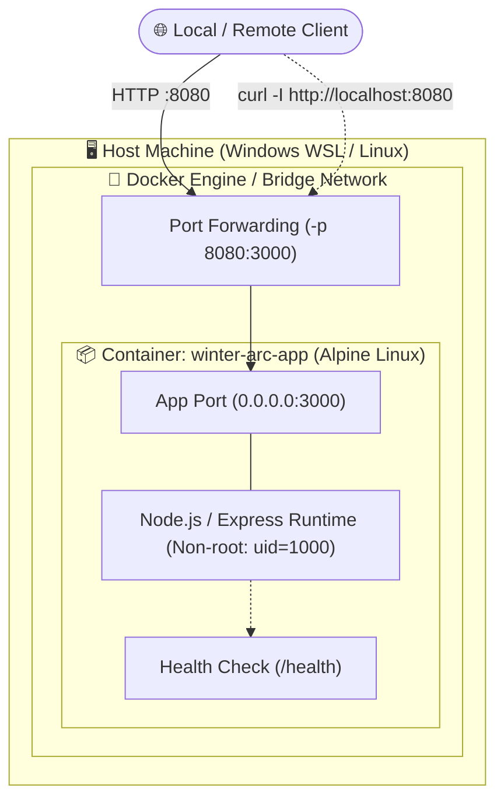

# 🚀 Day 32/90 — DevOps Winter Arc (Revision Week: Docker Image & Container Lab)

## 📌 Project Overview

This project represents **Day 32 of the DevOps Winter Arc challenge** (Revision + Integration Project Week - Day 3 of 7). It focuses on containerizing the integration application selected on Day 30 into a secure, optimized Docker image (`winter-arc-app:day32`), managing container lifecycles, configuring port mappings, enforcing non-root user security hardening, implementing container health checks, and performing a safe, controlled troubleshooting drill.

---

## 🏗️ Architecture Diagram


### Visual Topology & Service Flow



### Text Flow Summary

```text
Client ➔ HTTP Request (Port 8080) ➔ Docker Port Mapping (-p 8080:3000) ➔ Container Interface (Port 3000) ➔ Node.js Runtime (Non-root User)
```

---

## 🛠️ Key Components & Implementation

1. **Dockerfile & Build Optimization (Task A):**
   * Crafted an optimized multi-layered Dockerfile using `node:22-alpine` as a lightweight base image.
   * Configured intelligent caching by copying package manifests (`package.json`, `package-lock.json`) prior to source code injection, running `npm ci --omit=dev` for clean production installs.
   * Created a `.dockerignore` file to exclude local artifacts, `.git`, environment configuration files, and `node_modules` from the build context.

2. **Image Building & Container Execution (Task B):**
   * Built and tagged the container image cleanly using `docker build -t winter-arc-app:day32 .`.
   * Ran the container in detached mode with explicit host-to-container port publishing (`-p 8080:3000`).
   * Validated runtime responses using `curl -I http://localhost:8080` confirming valid HTTP status headers (`HTTP/1.1 200 OK`).

3. **Container Behavior & Security Hardening (Task C):**
   * Inspected container runtime configurations via `docker inspect` and verified process user permissions using `docker exec winter-arc-app id` to ensure non-root execution (`uid=1000`).
   * Configured a custom `HEALTHCHECK` directive to continuously probe application responsiveness and monitor container health status.

4. **Safe Controlled Troubleshooting Drill (Task D):**
   * Executed a controlled failure scenario (simulating port mapping mismatches and startup command errors) to diagnose failure symptoms using `docker ps -a`, `docker logs`, and `docker inspect`.
   * Applied configuration corrections, recreated containers, and validated full service recovery.

---

## 📁 Repository Structure

```text
day32-docker-lab/
├── architecture/
│   └── docker-container-lab.png    # Docker container network architecture diagram
├── app/
│   ├── Dockerfile                  # Optimized multi-layer container blueprint
│   ├── .dockerignore               # Build context exclusion rules
│   ├── package.json                # Node.js dependency manifests
│   └── index.js                    # Application server entrypoint
├── docs/
│   └── day32-docker-lab.md         # Detailed lab notes & incident recovery report
├── screenshots/
│   ├── 01_build_success.png        # Docker build output & layer caching
│   ├── 02_container_running.png    # docker ps and port forwarding output
│   ├── 03_app_browser_verified.png # Browser/curl endpoint response confirmation
│   ├── 04_logs_and_inspect.png     # Container logs and health status inspection
│   └── 05_successful_recovery.png  # Post-fix troubleshooting verification proof
└── README.md                       # Day 32 project documentation
```

---

## 🧪 Verification & Testing

- **Build & Layer Verification:** Confirmed successful build completion and clean layer caching via CLI build outputs.
- **Port & HTTP Response Verification:** Executed `curl -I http://localhost:8080` verifying successful response headers (`HTTP/1.1 200 OK`).
- **Troubleshooting & Incident Recovery Drill:**
  * **Symptom:** `curl` request failed with connection refused / container exited immediately.
  * **Evidence:** `docker ps -a` showed an `Exited (1)` status; `docker logs winter-arc-app` reported startup module errors.
  * **Root Cause:** Incorrect startup command or missing entrypoint dependency in test configuration.
  * **Fix:** Corrected command syntax in Dockerfile and recreated the container instance.
  * **Verification:** Re-ran `docker ps` and `curl` to confirm container status is `Up` and healthy.

---

## 💡 Key Takeaways & Interview Preparation

- **Image vs. Container:** An image is an immutable, packaged template of the application and its dependencies, whereas a container is a live, running runtime instance of that image.
- **Port Forwarding (`-p 8080:3000`):** Maps traffic arriving at host port `8080` directly to port `3000` exposed inside the isolated container network namespace.
- **Container Interface Binding (`0.0.0.0`):** Applications running inside containers must bind to network interface `0.0.0.0` (all interfaces) rather than `127.0.0.1` (loopback) to accept forwarded traffic from the host machine.
- **`.dockerignore` Optimization:** Essential for preventing sensitive credentials, local secrets, and heavy build folders (`node_modules`) from leaking into build contexts or container images.